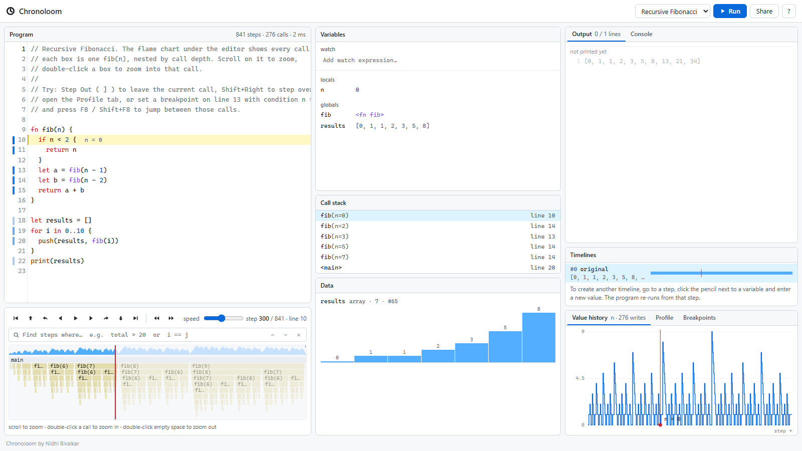
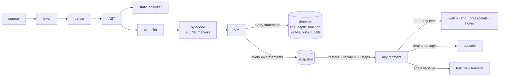

<div align="center">

# Chronoloom

**A programming language with a time-travel debugger, a flame-chart profiler and forkable timelines.**

Chronoloom records every statement a program executes. You can move backward and forward
through the run, search the whole history for the moment something went wrong, evaluate code
*in the past*, and set a variable to a different value at any step to re-run the program from
there as a separate timeline.



*Created by **Nidhi Bivalkar***

</div>

---

## Why

Ordinary debuggers only move forward. When something goes wrong you set a breakpoint, restart,
and hope to catch the bug in the act. Chronoloom records the **entire execution**, so every
moment can be revisited, searched, queried and branched into a "what if?"

It ships with **Loom**, a small scripting language built for this. Everything is written from
scratch in TypeScript: lexer, parser, static analyzer, bytecode compiler, a stack-based virtual
machine with exceptions and a deterministic garbage collector, a standard library written in Loom
itself, and a browser IDE built around time.

## Features

**Moving through time**
- **Flame chart of the whole run.** Every function call is a box, nested by call depth, laid out over time. Scroll to zoom, drag to scrub, double-click a call to zoom into it. An overview strip shows the entire run with output, search matches and forks.
- **Step in every direction:** forward and backward, step *over* calls both ways, and step *out* both ways.
- **Conditional breakpoints with reverse continue.** Click left of a line number, optionally add a condition like `n == 6`, then press F8 to run forward to the next hit, or Shift+F8 to run *backward* to the previous one.
- **Search the history.** Type an expression such as `vault.balance < 0` and Chronoloom replays the run, marking every step where it is true.
- **Reverse watchpoints.** Jump to the statement that last changed a variable, including mutations of the array or record it holds.

**Inspecting the past**
- **Watch expressions** that update at every step.
- **Hover** any variable or expression (`a[i].name`) in the editor to see its value at the current step.
- **Time-travel console.** Evaluate any expression *as if it ran at the current step*, including calls to your own functions (`fib(20)`, `map(xs, fn(x) => x * 2)`). It runs on a throwaway copy, so the recording is untouched.
- **Inline values** next to the current line, a **call stack** with arguments, and **faded output** for lines not printed yet.
- **Data views:** numeric arrays as bar charts with index pointers, 2D arrays as grids, records as tables, and aliases ("also data") when two names share one object.
- **Value-history charts** for any numeric variable.
- **Profiler:** calls, self steps and total steps per function, recursion-aware.

**Changing the past**
- **Fork timelines.** Set a variable to a new value at any step; the program re-runs from there as a new timeline and the original is kept.
- **Compare timelines.** Diverging output is highlighted, and charts overlay the parent timeline.

**Writing code**
- **Live diagnostics:** undefined variables (with "did you mean"), use before declaration, unused variables, unreachable code, wrong argument counts and assignment to builtins, underlined as you type.
- **Autocomplete** for keywords, builtins, the standard library and your own names.
- **Live re-run:** the program is re-recorded shortly after you stop typing.

**Also**
- A `loom` **command-line tool**: run, trace, heat map, history query, profile, fork comparison, lint and bytecode disassembly.
- **Shareable links** that encode the program and the current step.
- **13 example programs:** sorting, recursion, closures, exceptions, functional style, Game of Life, BFS maze solving, Monte Carlo π, Towers of Hanoi and a bug hunt.
- Light and dark themes that follow your OS.

## Quick start

Requires Node.js 20.19 or newer.

```bash
npm install
npm run dev        # open http://localhost:5173
```

Other scripts:

```bash
npm test           # run the test suite (vitest)
npm run build      # type-check + production build into dist/
npm run build:cli  # bundle the CLI into dist-cli/loom.js
```

### Things to try

1. **Bug hunt.** Open the *Bug hunt* example; it crashes because a balance goes negative.
   Type `vault.balance < 0` into the Find box under the editor and press Enter to land on the
   first bad step, or click the "previous change" arrow next to `vault` in the Variables panel.
2. **Recursive Fibonacci.** Look at the flame chart, open the Profile tab, then click left of
   line 13 to add a breakpoint, give it the condition `n == 6` in the Breakpoints tab, and press
   F8 / Shift+F8.
3. **Console.** At any step, open the Console tab and run something like `fib(20)`.
4. **Collatz sequence.** Click the plot button next to `n`, press <kbd>Home</kbd> then
   <kbd>→</kbd>, click the pencil next to `n` and enter `27`. A second timeline appears, and its
   chart is overlaid on the first.

### Keyboard

| Keys | Action |
| --- | --- |
| <kbd>←</kbd> / <kbd>→</kbd> | step back / forward |
| <kbd>Shift</kbd> + <kbd>←</kbd> / <kbd>→</kbd> | step over calls |
| <kbd>[</kbd> / <kbd>]</kbd> | step out (backward / forward) |
| <kbd>F8</kbd> / <kbd>Shift</kbd> + <kbd>F8</kbd> | continue to next / previous breakpoint hit |
| <kbd>Home</kbd> / <kbd>End</kbd> | first / last step |
| <kbd>Space</kbd> | play / pause |
| <kbd>/</kbd> | search the history |
| <kbd>Ctrl</kbd> + <kbd>Enter</kbd> | run |
| <kbd>Esc</kbd> | leave the editor so the arrow keys move between steps |
| <kbd>?</kbd> | help |

## The command line

```bash
npm run build:cli
node dist-cli/loom.js run examples/fib.loom
```

```text
$ loom query examples/bughunt.loom "vault.balance < 0"
5 steps where vault.balance < 0 (of 65)
  #   60 L30   push(v.log, "fee " + round(fee))
  #   61 L34   for day in 1..8 {
  ...

$ loom profile examples/fib.loom
function              calls     self    total
main                      1       23      841  ████████████████████████
fib                     276      818      818  ███████████████████████

$ loom fork examples/collatz.loom --at 1 --set n=27
T0 · original  85 steps, done
  steps: 16 peak: 52
T1 · n = 27  560 steps, done
  steps: 111 peak: 9232
Timelines diverge at output line 1.
```

| Command | What it does |
| --- | --- |
| `loom run <file>` | run a program (`--max-steps`, `--seed`) |
| `loom trace <file>` | print every recorded step with variable writes and output (`--from`, `--to`) |
| `loom query <file> "<expr>"` | every step where an expression is true |
| `loom profile <file>` | calls, self and total steps per function |
| `loom heat <file>` | source annotated with execution counts |
| `loom fork <file> --at N --set name=value` | run an alternate timeline and compare outputs |
| `loom check <file>` | syntax errors and lint warnings |
| `loom dis <file>` | disassemble to bytecode (`--all` includes the standard library) |

## The Loom language

```js
// variables, functions and closures
let greeting = "hello"
fn square(x) { return x * x }
fn double(x) => x * 2
let twice = fn(f, x) => f(f(x))
print("{greeting}: {twice(square, 3)}")   // hello: 81

// control flow
for i in 0..5 { print(i) }      // 0 to 4
for item in [1, 2, 3] { … }
for key in {a: 1, b: 2} { … }
while n > 1 and not done { … }
if x > 0 { … } else if x < 0 { … } else { … }

// errors
try {
  let x = [1, 2][10]
} catch err {
  print(err.message, err.line)   // runtime errors become catchable records
}
throw "anything can be thrown"

// data
let xs = [3, 1, 2]
xs[-1] = 10                      // negative indices count from the end
let p = {name: "Ada", age: 36}
p.age += 1
let board = grid(8, 8, 0)        // 2D array

// standard library
map(xs, fn(x) => x * 2)
filter(xs, fn(x) => x > 1)
reduce(xs, fn(a, b) => a + b, 0)
sortBy(words, fn(w) => len(w))
```

- Values: numbers, strings, booleans, `nil`, arrays, records and functions (first-class closures).
- Only `false` and `nil` are falsy. `+` concatenates strings with anything. `%` is a true modulo, so `-1 % 5 == 4`.
- Double-quoted strings interpolate `{expressions}`; use `\{` for a literal brace.
- Semicolons are optional. Function declarations are hoisted, so mutual recursion works.
- Errors are friendly: `Undefined variable 'totl'. Did you mean 'total'?`

**Builtins:** `print len push pop insert remove slice sort reverse copy fill grid range sum min max
has join split keys values upper lower trim char code str num int floor ceil round abs sqrt pow sin
cos atan2 log random randint seed type assert error PI`

**Standard library** (written in Loom): `map filter reduce each find findIndex indexOf any all count
times zip enumerate flatten unique sortBy`

`random()` is seeded and its state lives inside the machine, so every replay is identical.

## How it works



**1. Everything is data.** The VM's state (call frames, exception handlers, operand stack, heap,
PRNG state) is plain JSON-like data. Heap objects are addressed by integer ids, and closures
reference their environment by id. A snapshot is a structural copy that shares the parts that
never change after creation (references, functions, builtins) and copies the rest, which is
several times faster than `structuredClone`.

**2. Statements are the unit of time.** The compiler emits a `LINE` instruction at the start of
every statement and at the top of every loop iteration. Each executed `LINE` is one tick. While
recording, Chronoloom keeps cheap per-tick metadata (line, call depth, current function), a trace
of variable writes and object mutations, printed output, and the call tree (each call's
function, arguments and start/end tick).

**3. Checkpoints + deterministic replay.** Every 64 ticks a full snapshot is saved. To reach
moment *p*, the nearest snapshot at or before *p* is restored and the VM replays forward at most
63 statements. Seeking takes well under a millisecond. Replay is exact because the VM is
deterministic: randomness is seeded and stored in the snapshot, and nothing reads the clock.

**4. Deterministic garbage collection.** A mark-and-sweep collector runs only at statement
boundaries, triggered by heap size and by a fixed cadence aligned with the checkpoints, both of
which are part of the machine state. GC therefore happens at identical moments on every replay,
and snapshots only contain live objects.

**5. Exceptions are part of the machine state.** `try` pushes a handler (target, stack height,
scope) onto the current frame; `throw` and runtime errors unwind frames until a handler is found.
Because handlers live in the snapshot, programs that throw replay exactly. Uncaught errors keep
the full call stack for post-mortem debugging.

**6. Internal code stays off the timeline.** The standard library and console expressions are
compiled without `LINE` markers and with line number 0, so they run inside the user statement
that called them. Callbacks you pass in are ordinary user code, so they are still recorded.

**7. Inspection never disturbs the recording.** Watches, searches, breakpoint conditions and
hover use a read-only evaluator that cannot allocate or call functions. The console instead
compiles the expression into an extra function, runs it on a throwaway copy of the state, and
discards the copy.

**8. Forking is cheap.** A fork restores the state at the chosen moment, assigns the new value,
and records onward. The new timeline shares the parent's history up to the fork point; calls that
were still running at the fork are re-opened so the call tree stays correct.

## Project structure

```
src/
  core/            the language + time-travel engine (no DOM dependencies)
    lexer.ts       tokens, string interpolation, newline tracking for semicolon-free syntax
    parser.ts      recursive-descent parser → AST
    analyze.ts     static analysis (scopes, unused/undefined names, unreachable code, arity)
    compiler.ts    AST → stack bytecode, exception handlers, disassembler
    vm.ts          the virtual machine, builtins, exceptions, deterministic GC, snapshots
    stdlib.ts      the standard library, written in Loom
    evaluate.ts    read-only expression evaluation for watches, search and breakpoints
    values.ts      value model and formatting
    timeline.ts    recording, checkpoints, seeking, forking, call tree, profiler, queries, console
  ui/              the browser IDE (vanilla TypeScript + CodeMirror 6)
    editor.ts      highlighting, lint, autocomplete, hover, breakpoints, heat strip
    flame.ts       zoomable flame chart of the whole run
    inspect.ts     variables (fork / watchpoint actions) and call stack
    panels.ts      watches, console, profiler, breakpoint list
    data.ts        bar / grid / table visualiser
    output.ts      output with faded future lines
    multiverse.ts  the timeline tree
    chart.ts       value-history charts with parent-timeline overlay
  cli/main.ts      the `loom` command-line tool
  examples.ts      bundled example programs
examples/          the same examples as .loom files
tests/             language, time travel, exceptions, analyzer, queries, console and example tests
```

## Testing

```bash
npm test
```

85 tests cover the lexer, parser, every language feature, exceptions, the standard library and
the analyzer. The central invariant is checked directly: **the state reached by restoring a
checkpoint and replaying is identical to the state reached by running straight there**, compared
on a fingerprint of the whole machine at many positions and in random order, including for
programs that throw. Other tests cover forking (the parent is untouched, the call tree is
re-opened correctly), the call tree and profiler, history queries, conditional breakpoints in
both directions, the console not disturbing the recording, snapshot independence, GC
transparency, step limits, and every bundled example.

## Deploying

The repository includes a GitHub Actions workflow (`.github/workflows/ci.yml`) that runs the
tests and the build on every push, and deploys the IDE to **GitHub Pages** on pushes to `main`.
To turn it on, go to *Settings → Pages* and set **Source** to **GitHub Actions**.

## License

MIT © 2026 Nidhi Bivalkar
